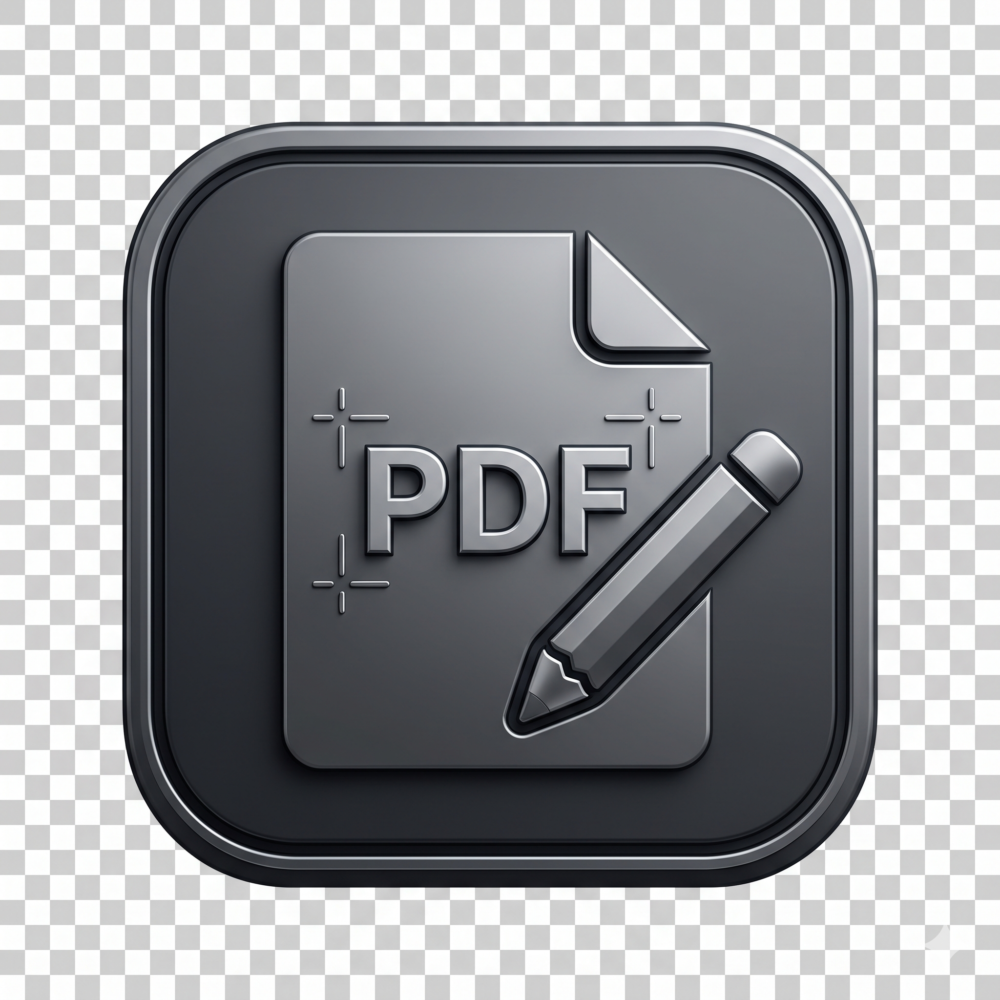

# My PDF Editor (QuickPDFEditor)

<p align="center">
  
</p>

**My PDF Editor (`QuickPDFEditor`)**는 **PyQt6**와 **PyMuPDF (`fitz`)** 기반으로 제작된 가볍고 빠른 데스크톱 PDF 뷰어 및 올인원 편집 도구입니다.  
문서 열람부터 **원본 서식 유지 텍스트 수정, 형광펜/도형 주석, 다중 페이지 추출, 드래그 앤 드롭 페이지 순서 변경, 외부 PDF 병합, 책갈피(TOC) 편집**까지 직관적인 단일 화면 UI에서 처리할 수 있습니다.

---

## 주요 기능 (Key Features)

### 1. PDF 열람 및 탐색
- 고해상도 렌더링 & 확대/축소: 40% ~ 400% 자유로운 줌 조절 및 Ctrl + 마우스 휠 확대/축소 지원
- 가상화(Lazy Rendering) 연속 스크롤 뷰어: 화면에 보이는 페이지만 실시간 렌더링하여 대용량 PDF도 메모리 부담 없이 연속 스크롤 열람 (상단 [연속 스크롤] 버튼 또는 Ctrl+Shift+C로 1페이지 보기 모드와 즉시 전환 가능)
- 오른쪽 뷰어 키보드/휠 페이지 이동: 방향키(←/→/↑/↓), PageUp/PageDown, Home/End, Space 키로 빠른 페이지 이동 및 좌측 썸네일 자동 동기화
- 썸네일 사이드바: 좌측 페이지 목록에서 빠른 페이지 이동 및 다중 페이지(Ctrl / Shift 클릭) 선택
- 접이식 책갈피(Bookmark) 드로어: 우측 슬라이드 패널에서 문서 목차(TOC) 조회, 현재 페이지 책갈피 추가 및 삭제

### 2. 정밀 텍스트 수정 및 주석 도구
- 원본 텍스트 수정 (Redaction & Insertion): 드래그한 영역의 원본 텍스트 폰트, 크기, 굵기(Bold), 기울임(Italic), 베이스라인(Baseline) 좌표 자동 감지
- Windows 시스템 설치 전체 폰트(970+종) 실시간 검색 필터 및 글자 색상(Color) 피커 지원
- 문서 내 텍스트 찾기 바 (Ctrl+F): 상단 슬림 검색 바에서 실시간 건수(N/M) 확인, 이전(Shift+Enter)/다음(Enter/F3) 순환 이동 및 재렌더링 없는 초경량 본문 하이라이트 오버레이 지원
- 형광펜 (Highlight, Ctrl+Shift+H): 마우스 드래그 영역에 반투명 하이라이트 주석 추가 (노랑·연두·하늘·분홍·주황 프리셋 및 자유 색상 선택 지원)
- 사각 테두리 박스 (Rect Box, Ctrl+Shift+B): 주요 영역 강조를 위한 사각 박스 마킹 (테두리 색상 및 두께 0.5~12pt 자유 조절)
- 클라우드 마크 (Cloud Mark, Ctrl+Shift+M): 마우스 다중 클릭으로 다각형 면적과 내부 빗금(Hatch)을 실시간 확인하며 구름 모양 마크업 생성 (선 색상, 선 두께, 구름 크기 1.0~5.0배 조절 지원)
- 당초/변경 마크 (Stamp Mark, Ctrl+Shift+D): 페이지 우측 상단에 빨간색 굵은 사각형 테두리 안의 '당초' 또는 '변경' 마크를 페이지별로 개별/일괄 삽입 (박스 크기, 테두리 색상·굵기, 글자 크기·폰트 및 여백 실시간 미리보기 조정 지원)
- 쪽번호 넣기 (Ctrl+Shift+N): '-1-' 형식으로 시작 페이지 및 시작 번호를 지정하고, 하단 좌측/중앙/우측 정렬과 기존 글자 겹침 방지를 위한 상·하 위치 미세 조정(실시간 미리보기 포함) 지원

### 3. 페이지 관리 (병합 · 추출 · 이동 · 회전 · 삭제)
- 외부 PDF 페이지 합병 (Merge): 다른 PDF 파일의 첫 페이지 썸네일 미리보기 확인 및 전체/원하는 페이지 구간(예: 1-3, 5) 지정 삽입
- 탐색기 드래그 앤 드롭 합병: Windows 탐색기에서 PDF 파일을 좌측 페이지 목록으로 드래그 앤 드롭하여 원하는 위치에 즉시 합병
- 드래그 앤 드롭 페이지 순서 변경: 좌측 썸네일 목록에서 페이지를 마우스로 끌어 실시간 삽입 가이드라인 위치를 확인한 뒤 순서 재배치
- 선택 페이지 추출 (Extract): 다중 선택한 페이지들을 새로운 PDF 파일로 즉시 분리 저장
- 페이지 회전 및 삭제: 선택 페이지 90° 시계 방향 회전 및 다중 페이지 일괄 삭제

### 4. 인쇄 및 안전한 편집 이력 관리
- 실시간 미리보기 인쇄 (Ctrl+P): 대상 프린터 선택(PDF로 저장 포함), 페이지 범위(전체/홀수/짝수/맞춤 구간), 매수, 컬러/흑백, 용지 크기(A4/A3/B4/B5/Letter/Legal), 시트당 페이지 수(1/2/4/6/9/16 N-up 모아찍기), 품질(300/600/1200dpi), 배율(기본값/용지에 맞춤/맞춤%), 양면 인쇄 및 시스템 인쇄 대화상자(Ctrl+Shift+P) 지원
- 실행 취소 / 다시 실행 (Undo / Redo): 메모리 스냅샷 기반으로 최대 10단계까지 모든 편집 작업(텍스트 수정, 주석, 회전, 삭제, 이동, 병합, 책갈피) 즉시 복원 (Ctrl+Z / Ctrl+Y)
- 미저장 변경사항 보호: 문서 수정 시 타이틀바에 * 표시 및 문서 닫기(Ctrl+W)·프로그램 종료·새 파일 열기 시 저장 여부 확인 알림창 제공

---

## 단축키 안내 (Keyboard Shortcuts)

| 분류 | 단축키 | 동작 설명 |
| :--- | :--- | :--- |
| **파일(F)** | `Ctrl + O` | PDF 문서 열기 |
| **파일(F)** | `Ctrl + S` | 변경된 PDF 문서 저장 |
| **파일(F)** | `Ctrl + Shift + S` | 새 이름으로 저장 |
| **파일(F)** | `Ctrl + P / Ctrl + Shift + P` | 인쇄 / 인쇄 설정 |
| **파일(F)** | `Ctrl + W` | 현재 열려 있는 문서 닫기 |
| **파일(F)** | `Alt + F4 (또는 Ctrl + Q)` | 프로그램 종료 |
| **편집(E)** | `Ctrl + Z` | 실행 취소 (Undo, 최대 10단계) |
| **편집(E)** | `Ctrl + Y / Ctrl + Shift + Z` | 다시 실행 (Redo, 최대 10단계) |
| **편집(E)** | `Ctrl + F (Enter / Shift+Enter / Esc)` | 상단 텍스트 찾기 바 열기 (다음 찾기 / 이전 찾기 / 닫기) |
| **편집(E)** | `Ctrl + E / Esc` | 텍스트 수정 모드 전환 / 일반 선택 모드 복귀 |
| **보기(V)** | `Ctrl + + / Ctrl + -` | 화면 확대 / 축소 (또는 Ctrl + 마우스 휠) |
| **보기(V)** | `F9 / Ctrl + B` | 좌측 페이지 목록 / 우측 책갈피 창 표시·숨기기 |
| **보기(V)** | `Ctrl + Shift + T` | 상단 도구 모음(툴바) 표시·숨기기 |
| **보기(V)** | `Ctrl + Shift + C` | 가상화 연속 스크롤 보기 ↔ 단일 페이지 보기 전환 |
| **보기(V)** | `PgUp / PgDn / 방향키 / Home / End` | 오른쪽 뷰어 창에서 페이지 및 스크롤 이동 |
| **작업(W)** | `Ctrl + Shift + B` | 박스 검토(사각 마크업) 모드 전환 (테두리 색상·두께 조절) |
| **작업(W)** | `Ctrl + Shift + M` | 클라우드 마크(다중 클릭 구름 마크업) 모드 전환 (선 색상·두께·구름 크기 조절) |
| **작업(W)** | `Ctrl + Shift + H` | 형광펜 하이라이트 모드 전환 (색상 변경 지원) |
| **작업(W)** | `Ctrl + Shift + D` | 당초/변경 마크 모드 전환 (우측 상단 클릭 즉시 삽입 및 페이지별 설정) |
| **작업(W)** | `Ctrl + Shift + N` | 쪽번호 넣기 |
| **도움말(H)** | `F1 / Ctrl + F1` | 도움말 보기 / 프로그램 정보 및 변경 이력 보기 |
| **마우스 조작** | `Ctrl + 클릭 / Shift + 클릭` | 페이지 목록에서 개별 / 연속 구간 다중 페이지 선택 |

---

## 프로젝트 구조 (Directory Structure)

```text
My_PDF_Editer/
├── main.py                        # 애플리케이션 진입점 (Entry Point)
├── build.py                       # 버전 메타데이터 동적 생성 및 PyInstaller 원클릭 빌드 스크립트
├── git_workflow.py                # Git 브랜치/태그/릴리스 자동화 헬퍼 스크립트
├── requirements.txt               # Python 패키지 의존성 목록
├── My_pdf_editer_icon.png         # 애플리케이션 원본 아이콘
├── assets/
│   └── app_icon.ico               # 빌드 시 자동 변환되는 멀티 사이즈 Windows 아이콘
├── src/
│   ├── __version__.py             # 시맨틱 버전(v1.0.0) 및 릴리스 노트 중앙 관리
│   ├── controllers/
│   │   └── main_controller.py     # View 시그널과 Model 비즈니스 로직 연결 (MVC Controller)
│   ├── models/
│   │   └── pdf_document.py        # PyMuPDF(fitz) 래퍼, Undo/Redo 스택, 렌더링/편집 엔진 (MVC Model)
│   ├── utils/
│   │   └── coord_converter.py     # 화면 픽셀 좌표(QRectF) ↔ PDF 포인트 좌표(fitz.Rect) 정밀 변환기
│   └── views/
│       ├── main_window.py         # 메인 윈도우, 1줄 모던 툴바, 좌측 썸네일 리스트, 우측 책갈피 드로어
│       ├── canvas_view.py         # PDF 페이지 렌더링 캔버스 및 마우스 드래그 인터랙션 뷰
│       └── merge_dialog.py        # 외부 PDF 합병 설정 및 미리보기 다이얼로그
├── releases/
│   └── v1.0.0/
│       └── RELEASE_NOTES_v1.0.0.txt
└── .github/
    └── workflows/
        └── build-release.yml      # 태그 푸시 시 Windows 단일 EXE 자동 빌드 & GitHub Release 배포
```

---

## 설치 및 실행 방법 (Getting Started)

### 1. 실행 파일(`.exe`) 바로 다운로드
Python 설치 없이 바로 실행하려면 우측 **[Releases](https://github.com/SeolJongMyoung/My_PDF_Editer_beta/releases)** 탭에서 최신 버전의 `QuickPDFEditor_v1.1.0.exe` 파일을 다운로드하여 실행하세요.

### 2. 소스 코드로 실행 (개발 환경)
- **권장 환경**: Windows 10/11, Python 3.10 이상

```bash
# 1. 저장소 클론
git clone https://github.com/SeolJongMyoung/My_PDF_Editer_beta.git
cd My_PDF_Editer_beta

# 2. 의존성 패키지 설치
pip install -r requirements.txt

# 3. 애플리케이션 실행
python main.py
```

---

## 단일 실행 파일(`.exe`) 빌드 방법

프로젝트 루트의 `build.py`를 실행하면 `src/__version__.py`의 버전 정보를 읽어 **Windows 파일 속성 메타데이터(`file_version_info.txt`)** 및 **아이콘(`assets/app_icon.ico`)**을 자동 생성한 뒤, `releases/v{버전}/` 폴더에 단일 실행 파일(`QuickPDFEditor_v{버전}.exe`)과 릴리스 노트를 패키징합니다.

```bash
# 전체 빌드 수행 (releases/v1.0.0/QuickPDFEditor_v1.1.0.exe 생성)
python build.py

# 컴파일 없이 버전 메타데이터 및 아이콘 생성만 검증 (Dry-Run)
python build.py --dry-run
```

---

## GitHub Actions 자동 릴리스 (CI/CD)

`.github/workflows/build-release.yml` 워크플로우가 구성되어 있어, `v*` 형식의 Git 태그를 푸시하면 GitHub Actions의 `windows-latest` 러너에서 자동으로 단일 `.exe`를 빌드하고 **GitHub Releases**에 첨부 파일을 등록합니다.

```bash
git tag -a v1.0.0 -m "Release v1.0.0"
git push origin v1.0.0
```

---

## 변경 이력 (Changelog)

### v1.1.0 (2026-10-20)
- 실시간 용지 미리보기 인쇄 대화상자(Ctrl+P) 추가: 프린터/PDF 저장 선택, 페이지 범위, 매수, 컬러/흑백, 용지 크기, 시트당 페이지 수(1/2/4/6/9/16 모아찍기), 품질(DPI), 배율, 양면 인쇄 및 시스템 인쇄 대화상자(Ctrl+Shift+P) 지원
- 오른쪽(중앙) 뷰어에 메모리 최적화 가상화(Lazy Rendering) 연속 스크롤 모드 도입 및 단일 페이지 보기 전환 스위치(Ctrl+Shift+C) 추가
- 오른쪽 뷰어에서 마우스 휠 및 키보드(PgUp/PgDn, 방향키, Home/End, Space) 페이지 이동과 좌측 썸네일 자동 동기화 구현
- 당초/변경 마크(Ctrl+Shift+D) 기능 추가: 페이지 우측 상단에 빨간색 굵은 사각형 테두리 안의 '당초' 또는 '변경' 마크를 클릭 한 번으로 넣거나 페이지별 일괄·개별 설정 대화상자에서 미리보기와 함께 적용
- 도구별 컨텍스트 속성 설정 바(Contextual Property Bar) 추가: 박스 검토(테두리 두께·색상), 클라우드 마크(선 두께·색상·클라우드 크기), 하이라이트(색상), 당초/변경 마크(박스 크기·테두리 색상 및 굵기·글자 크기 및 폰트)를 도구 선택 시 상단에서 즉시 개별 조절
- 다중 클릭 다각형 기반 클라우드 마크(Revision Cloud, Ctrl+Shift+M) 주석 도구 및 내부 빗금(Hatch) 실시간 미리보기 추가
- 쪽번호 넣기 대화상자(Ctrl+Shift+N) 추가: '-1-' 등 형식 선택, 시작/끝 페이지 및 시작 번호 지정, 하단 좌/중/우 정렬 및 기존 글자 겹침 방지를 위한 상·하 위치 미세 조정(실시간 미리보기 지원)
- 상단 슬림 텍스트 찾기 바(Ctrl+F) 및 재렌더링 없는 초경량 본문 검색 하이라이트 오버레이(Enter/Shift+Enter/F3 순환 이동) 구현
- 상단 메뉴 표시줄(파일, 편집, 보기, 작업, 도움말), 문서 닫기(Ctrl+W), 패널별 표시/숨기기(F9, Ctrl+B, Ctrl+Shift+T) 및 도움말(F1) 전용 다이얼로그 신설

### v1.0.0 (2026-10-19)
- 외부 PDF 파일 페이지 합병(삽입) 기능 추가 (미리보기 썸네일, 구간 지정, 탐색기 드래그 앤 드롭 지원)
- 페이지 목록 드래그 앤 드롭 순서 이동 기능 추가 (실시간 가로 구분선 표시 및 이동 확인 대화창)
- Ctrl/Shift 다중 페이지 선택 및 선택 페이지 새 PDF 추출 저장 기능
- 텍스트 수정 고도화: 윈도우 설치 전체 폰트(970+종) 스캔·검색 필터 및 글자 색상(Color) 변경 기능
- 최대 10단계 실행 취소(Undo, Ctrl+Z) / 다시 실행(Redo, Ctrl+Y) 및 종료 시 미저장 변경사항 확인
- 오른쪽 접이식 책갈피(Bookmark) 드로어 패널 및 모던 그레이스케일 1줄 툴바 UI 적용

### v0.3.0 (2026-10-19)
- 원본 PDF 텍스트의 폰트·크기·굵기·기울임·베이스라인(Baseline) 자동 감지 및 정밀 치환
- 페이지 목록 썸네일 선택 시 페이지 번호 텍스트를 제외한 이미지 박스 단독 하이라이트 적용
- 흰색 바탕 캔버스 및 접이식 책갈피 관리(조회/추가/삭제) 기능 구현

### v0.1.0 (2026-10-19)
- PyQt6 + PyMuPDF(fitz) MVC 아키텍처 설계 및 화면-PDF 좌표 정밀 변환(CoordConverter) 구현
- PDF 열기/저장, 확대/축소(Zoom), 페이지 회전/삭제, 사각 박스 검토 및 형광펜 하이라이트 모드 구현
